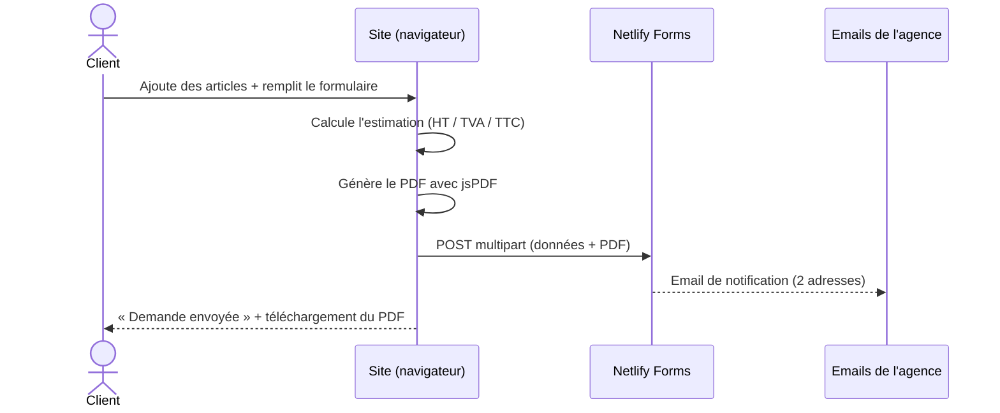
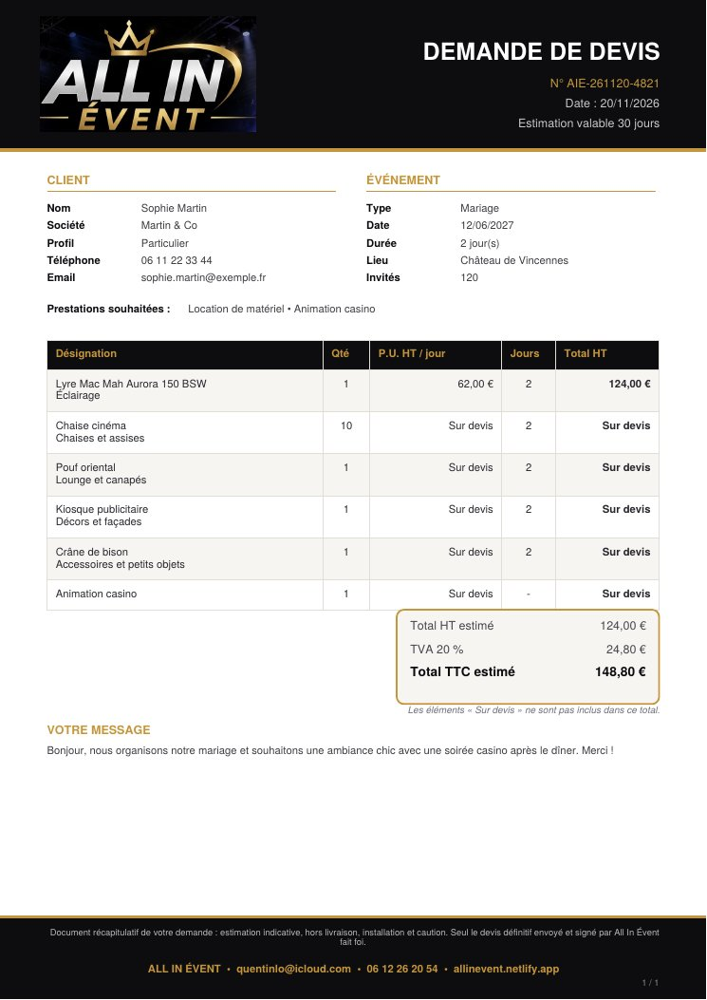

<div align="center">

# 👑 All In Évent

**Site vitrine, catalogue de location et demande de devis en ligne pour une agence événementielle.**

Casino · Structures gonflables · Son & Lumière · Team building · Décoration sur mesure

[](https://allinevent.netlify.app)
[](https://www.netlify.com)


</div>

---

## 📋 Sommaire

- [Présentation](#-présentation)
- [Fonctionnalités](#-fonctionnalités)
- [Fonctionnement du devis](#-fonctionnement-du-devis)
- [Stack technique](#-stack-technique)
- [Structure du projet](#-structure-du-projet)
- [Lancer et modifier le site](#-lancer-et-modifier-le-site)
- [Déploiement](#-déploiement)
- [Sécurité](#-sécurité)
- [Crédits](#-crédits)

---

## 🎯 Présentation

**All In Évent** propose aux particuliers, entreprises et collectivités la location de matériel événementiel et l'organisation clé en main d'événements.

Le site permet au client de :

1. **parcourir le catalogue** (203 articles avec photos et prix à la journée) ;
2. **composer sa sélection** et voir une estimation du prix en temps réel ;
3. **envoyer une demande de devis** en 3 étapes ;
4. **recevoir immédiatement un PDF récapitulatif** de sa demande.

L'agence reçoit chaque demande **par email**, avec le PDF joint.

---

## ✨ Fonctionnalités

| | Fonctionnalité | Détail |
|---|---|---|
| 🏠 | **Site multipage** | Accueil, Location, Prestations, Casino, Événements, L'agence, Devis, Mentions légales, avec navigation sans rechargement |
| 🛒 | **Catalogue** | 203 articles répartis en 3 rayons et 28 catégories, avec recherche (insensible aux accents), filtres et bascule des prix **HT / TTC** |
| 🧮 | **Estimation en direct** | Panier avec quantités, durée de location, calcul HT, TVA 20 % et TTC |
| 📝 | **Formulaire en 3 étapes** | Coordonnées → Événement → Projet, avec validation des champs |
| 📄 | **Devis PDF** | Généré dans le navigateur : logo, numéro unique, client, événement, tableau des articles, totaux et mentions |
| 📬 | **Notifications** | Chaque demande est envoyée aux 2 adresses de l'agence via Netlify Forms, PDF joint |
| 🎬 | **Design** | Thème noir et or, vidéo de fond, logo animé, apparition des sections au défilement |
| 📱 | **Responsive** | Adapté aux ordinateurs, tablettes et téléphones (vidéo plus légère sur mobile) |
| ♿ | **Accessibilité** | Respect de `prefers-reduced-motion` (animations et vidéo désactivées si demandé) |

---

## 📄 Fonctionnement du devis



<div align="center">

<br><em>Exemple de PDF généré (client fictif)</em>
</div>

> ℹ️ Le PDF est une **demande de devis / estimation indicative**, hors livraison, installation et caution. Seul le devis définitif envoyé par l'agence fait foi.

---

## 🛠 Stack technique

- **HTML5 / CSS3 / JavaScript** (vanilla, sans framework) : tout le site tient dans un seul fichier `index.html`
- **[jsPDF](https://github.com/parallax/jsPDF)** + **[jsPDF-AutoTable](https://github.com/simonbengtsson/jsPDF-AutoTable)** : génération du PDF côté client (chargés depuis cdnjs)
- **[Netlify](https://www.netlify.com)** : hébergement, HTTPS et **Netlify Forms** pour la réception des demandes
- **Python** : petit script `build.py` qui assemble le site à partir des sources
- **Google Fonts** : Montserrat et Cinzel

---

## 📁 Structure du projet

```
.
├── index.html          # Site complet, prêt à publier (généré par build.py)
├── build.py            # Assemble index.html à partir de src/
├── src/
│   ├── site.html       # Structure, textes et JavaScript
│   ├── base.css        # Styles de base (thème noir et or)
│   ├── produits.txt    # Catalogue : rayon|catégorie|nom|prix HT/jour
│   ├── photos.csv      # Photo associée à chaque produit
│   ├── logo.jpg        # Logo sur fond noir (utilisé dans le PDF)
│   └── logo.webp       # Logo détouré (utilisé sur le site)
└── docs/               # Captures d'écran du README
```

### Format du catalogue (`src/produits.txt`)

Une ligne par produit, champs séparés par `|` :

```text
son|Sonorisation|Caisson FBT X-Sub 118SA|96
mob|Tables|Table ronde|15
deco|Décors et façades|Télésiège|
```

| Champ | Valeurs |
|---|---|
| Rayon | `son` (Sono, lumière et vidéo), `mob` (Mobilier), `deco` (Décoration) |
| Catégorie | Sous-rayon affiché dans les filtres |
| Nom | Nom du produit |
| Prix | Prix **HT par jour** en euros, **vide = « Sur devis »** |

> ⚠️ `src/photos.csv` suit le **même ordre** que `produits.txt`. Si tu ajoutes un produit, ajoute aussi une entrée dans `photos.csv` (`-` pour utiliser la photo de la catégorie).

---

## 🚀 Lancer et modifier le site

**Voir le site en local :** il suffit d'ouvrir `index.html` dans un navigateur. Aucune installation n'est nécessaire.

**Modifier le site :**

```bash
# 1. Modifier les fichiers dans src/ (textes, prix, produits…)
# 2. Régénérer index.html
python3 build.py
# 3. Vérifier en ouvrant index.html, puis publier (voir ci-dessous)
```

> Le formulaire de devis ne fonctionne qu'une fois le site **en ligne sur Netlify**. En local, il affiche un message d'erreur, ce qui est normal.

---

## 🌍 Déploiement

Le site est hébergé sur **Netlify** : https://allinevent.netlify.app

**Mise à jour par glisser-déposer :**
Netlify → projet **allinevent** → **Deploys** → glisser `index.html` (ou un dossier / zip le contenant) dans la zone de dépôt.

**Prérequis Netlify Forms (déjà configuré) :**
- *Forms → Form detection* : activé
- *Forms → Submission notifications* : emails de l'agence ajoutés et confirmés

---

## 🔒 Sécurité

**Déjà en place :**
- HTTPS fourni par Netlify
- Champ **honeypot** anti-robots sur le formulaire
- Échappement des données saisies avant leur affichage (prévention XSS)
- Aucune clé d'API ni secret dans le code

**Améliorations prévues :**
- [ ] En-têtes de sécurité HTTP (CSP, HSTS, X-Frame-Options…) via un fichier `_headers`
- [ ] Subresource Integrity (SRI) sur les scripts chargés depuis le CDN
- [ ] Limites de longueur sur les champs et CAPTCHA
- [ ] Consentement RGPD sur le formulaire et politique de confidentialité
- [ ] Fichier `/.well-known/security.txt` (RFC 9116)

---

## 🙏 Crédits

- Photos d'illustration : [Unsplash](https://unsplash.com) (licence Unsplash)
- Vidéo de fond : [Pexels](https://www.pexels.com) (licence Pexels)
- Génération PDF : [jsPDF](https://github.com/parallax/jsPDF) (MIT) et [jsPDF-AutoTable](https://github.com/simonbengtsson/jsPDF-AutoTable) (MIT)

Les photos sont des illustrations non contractuelles du matériel proposé.

---

<div align="center">

**All In Évent** · Créons ensemble des événements inoubliables

Particuliers • Entreprises • Collectivités

Réalisé par [Yanis Dardaz](https://github.com/yanisdardaz)

</div>
