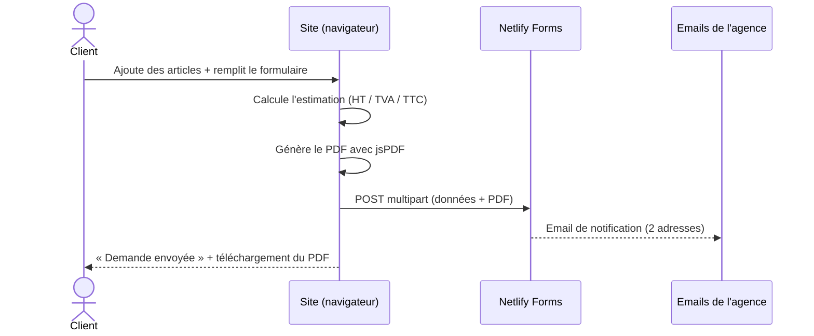

<div align="center">

# 👑 All In Évent

**Site vitrine, catalogue de location et demande de devis en ligne pour une agence événementielle.**

Casino · Structures gonflables · Son & Lumière · Team building · Décoration sur mesure

[](https://allinevent.netlify.app)
[](https://www.netlify.com)


</div>

---

## 📋 Sommaire

- [Présentation](#-présentation)
- [Fonctionnalités](#-fonctionnalités)
- [Fonctionnement du devis](#-fonctionnement-du-devis)
- [Stack technique](#-stack-technique)
- [Structure du projet](#-structure-du-projet)
- [Lancer et modifier le site](#-lancer-et-modifier-le-site)
- [Déploiement](#-déploiement)
- [Sécurité](#-sécurité)
- [Crédits](#-crédits)

---

## 🎯 Présentation

**All In Évent** propose aux particuliers, entreprises et collectivités la location de matériel événementiel et l'organisation clé en main d'événements.

Le site permet au client de :

1. **parcourir le catalogue** (203 articles avec photos et prix à la journée) ;
2. **composer sa sélection** et voir une estimation du prix en temps réel ;
3. **envoyer une demande de devis** en 3 étapes ;
4. **recevoir immédiatement un PDF récapitulatif** de sa demande.

L'agence reçoit chaque demande **par email**, avec le PDF joint.

---

## ✨ Fonctionnalités

| | Fonctionnalité | Détail |
|---|---|---|
| 🏠 | **Site multipage** | Accueil, Location, Prestations, Casino, Événements, L'agence, Devis, Mentions légales, avec navigation sans rechargement |
| 🛒 | **Catalogue** | 203 articles répartis en 3 rayons et 25 catégories, avec recherche (insensible aux accents), filtres et bascule des prix **HT / TTC** |
| 🧮 | **Estimation en direct** | Panier avec quantités, durée de location, calcul HT, TVA 20 % et TTC |
| 📝 | **Formulaire en 3 étapes** | Coordonnées → Événement → Projet, avec validation des champs |
| 📄 | **Devis PDF** | Généré dans le navigateur : logo, numéro unique, client, événement, tableau des articles, totaux et mentions |
| 📬 | **Notifications** | Chaque demande est envoyée aux 2 adresses de l'agence via Netlify Forms, PDF joint |
| 🎬 | **Design** | Thème noir et or, vidéo de fond, logo animé, apparition des sections au défilement |
| 📱 | **Responsive** | Adapté aux ordinateurs, tablettes et téléphones (vidéo plus légère sur mobile) |
| ♿ | **Accessibilité** | Respect de `prefers-reduced-motion` (animations et vidéo désactivées si demandé) |

---

## 📄 Fonctionnement du devis



<div align="center">

<br><em>Exemple de PDF généré (client fictif)</em>
</div>

> ℹ️ Le PDF est une **demande de devis / estimation indicative**, hors livraison, installation et caution. Seul le devis définitif envoyé par l'agence fait foi.

---

## 🛠 Stack technique

- **HTML5 / CSS3 / JavaScript** (vanilla, sans framework) : pages, styles, catalogue et logique réunis dans `index.html`
- **[jsPDF](https://github.com/parallax/jsPDF)** + **[jsPDF-AutoTable](https://github.com/simonbengtsson/jsPDF-AutoTable)** : génération du PDF côté client (hébergés sur le site, aucun CDN tiers)
- **[Netlify](https://www.netlify.com)** : hébergement, HTTPS et **Netlify Forms** pour la réception des demandes
- **Python** : petit script `build.py` qui assemble le site à partir des sources
- **Polices Montserrat et Cinzel** hébergées sur le site (aucun appel à Google Fonts)

---

## 📁 Structure du projet

```
.
├── build.py                    # Construit public/ à partir de src/
├── public/                     # ⇦ Dossier à publier sur Netlify (généré)
│   ├── index.html              #   Site complet
│   ├── _headers                #   En-têtes de sécurité HTTP (CSP, HSTS…)
│   ├── .well-known/security.txt#   Contact sécurité (RFC 9116)
│   ├── fonts/                  #   Polices hébergées sur le site
│   └── vendor/                 #   jsPDF + AutoTable
├── src/
│   ├── site.html               # Structure, textes et JavaScript
│   ├── base.css                # Styles de base (thème noir et or)
│   ├── produits.txt            # Catalogue : rayon|catégorie|nom|prix HT/jour
│   ├── photos.csv              # Photo associée à chaque produit
│   ├── logo.jpg / logo.webp    # Logo (fond noir pour le PDF, détouré pour le site)
│   ├── fonts/                  # Polices Montserrat et Cinzel (licence OFL)
│   └── vendor/                 # Bibliothèques PDF (licence MIT)
└── docs/                       # Captures d'écran du README
```

### Format du catalogue (`src/produits.txt`)

Une ligne par produit, champs séparés par `|` :

```text
son|Sonorisation|Caisson FBT X-Sub 118SA|96
mob|Tables|Table ronde|15
deco|Décors et façades|Télésiège|
```

| Champ | Valeurs |
|---|---|
| Rayon | `son` (Sono, lumière et vidéo), `mob` (Mobilier), `deco` (Décoration) |
| Catégorie | Sous-rayon affiché dans les filtres |
| Nom | Nom du produit |
| Prix | Prix **HT par jour** en euros, **vide = « Sur devis »** |

> ⚠️ `src/photos.csv` suit le **même ordre** que `produits.txt`. Si tu ajoutes un produit, ajoute aussi une entrée dans `photos.csv` (`-` pour utiliser la photo de la catégorie).

---

## 🚀 Lancer et modifier le site

**Voir le site en local :**

```bash
python3 build.py                              # construit public/
python3 -m http.server 8000 --directory public  # puis ouvrir http://localhost:8000
```

**Modifier le site :**

```bash
# 1. Modifier les fichiers dans src/ (textes, prix, produits…)
# 2. Reconstruire public/ (recalcule aussi l'empreinte CSP du script)
python3 build.py
# 3. Vérifier en local, puis publier le dossier public/ (voir ci-dessous)
```

> ⚠️ Toujours repasser par `build.py` après une modification : la politique de sécurité (CSP) n'autorise que le script dont l'empreinte a été calculée. Un `index.html` modifié à la main serait bloqué par le navigateur.

> Le formulaire de devis ne fonctionne qu'une fois le site **en ligne sur Netlify**. En local, il affiche un message d'erreur, ce qui est normal.

---

## 🌍 Déploiement

Le site est hébergé sur **Netlify** : https://allinevent.netlify.app

**Mise à jour par glisser-déposer :**
Netlify → projet **allinevent** → **Deploys** → glisser le **dossier `public/`** (ou un zip de ce dossier) dans la zone de dépôt.

> Il faut publier le dossier complet, pas seulement `index.html` : les en-têtes de sécurité (`_headers`), `security.txt`, les polices et les bibliothèques en font partie.

**Prérequis Netlify Forms (déjà configuré) :**
- *Forms → Form detection* : activé
- *Forms → Submission notifications* : emails de l'agence ajoutés et confirmés

---

## 🔒 Sécurité

| Mesure | Protection |
|---|---|
| **Content-Security-Policy** stricte | Le seul script inline est autorisé par son **empreinte SHA-256** (pas de `'unsafe-inline'` pour les scripts) ; images et vidéo limitées à Unsplash et Pexels ; `object-src 'none'`, `base-uri 'self'`, `form-action 'self'` → limite fortement les injections de scripts (XSS) |
| **Strict-Transport-Security** | Force le HTTPS pendant 1 an |
| **X-Frame-Options: DENY** + `frame-ancestors 'none'` | Empêche l'affichage du site dans une iframe (clickjacking) |
| **X-Content-Type-Options**, **Referrer-Policy**, **Permissions-Policy**, **COOP** | Durcissement du navigateur (pas de détection de type MIME, référent limité, caméra, micro et géolocalisation désactivés…) |
| **Aucune dépendance tierce exécutée** | jsPDF et les polices sont hébergés sur le site : pas de risque de CDN compromis, pas de fuite d'IP vers Google Fonts |
| **Formulaire** | Champ **honeypot**, filtrage anti-spam de Netlify, longueurs maximales, format du téléphone et de l'email vérifiés, données échappées avant affichage |
| **RGPD** | Case de consentement obligatoire, politique de confidentialité, aucun cookie ni traceur |
| **Email masqué** | L'adresse de contact n'apparaît pas en clair dans le HTML (reconstruite en JavaScript) contre les robots collecteurs |
| **security.txt** | `/.well-known/security.txt` (RFC 9116) pour signaler une vulnérabilité |
| **Secrets** | Aucune clé d'API ni mot de passe dans le code |

**Vérifier :** [securityheaders.com](https://securityheaders.com/?q=https%3A%2F%2Fallinevent.netlify.app&followRedirects=on) · [Mozilla Observatory](https://developer.mozilla.org/fr/observatory/analyze?host=allinevent.netlify.app)

**Pistes suivantes :**
- [ ] Remplacer `'unsafe-inline'` des styles par des empreintes (déplacer les attributs `style=""` dans le CSS)
- [ ] CAPTCHA si le spam augmente (le reCAPTCHA intégré à Netlify n'est pas compatible avec l'envoi en JavaScript ; il faudrait une clé reCAPTCHA ou hCaptcha dédiée)
- [ ] Double authentification (2FA) activée sur les comptes Netlify et GitHub

---

## 🙏 Crédits

- Photos d'illustration : [Unsplash](https://unsplash.com) (licence Unsplash)
- Vidéo de fond : [Pexels](https://www.pexels.com) (licence Pexels)
- Génération PDF : [jsPDF](https://github.com/parallax/jsPDF) (MIT) et [jsPDF-AutoTable](https://github.com/simonbengtsson/jsPDF-AutoTable) (MIT)
- Polices : [Montserrat](https://fonts.google.com/specimen/Montserrat) et [Cinzel](https://fonts.google.com/specimen/Cinzel) (SIL Open Font License), via [Fontsource](https://fontsource.org)

Les photos sont des illustrations non contractuelles du matériel proposé.

---

<div align="center">

**All In Évent** · Créons ensemble des événements inoubliables

Particuliers • Entreprises • Collectivités

Réalisé par [Yanis Dardaz](https://github.com/yanisdardaz)

</div>
